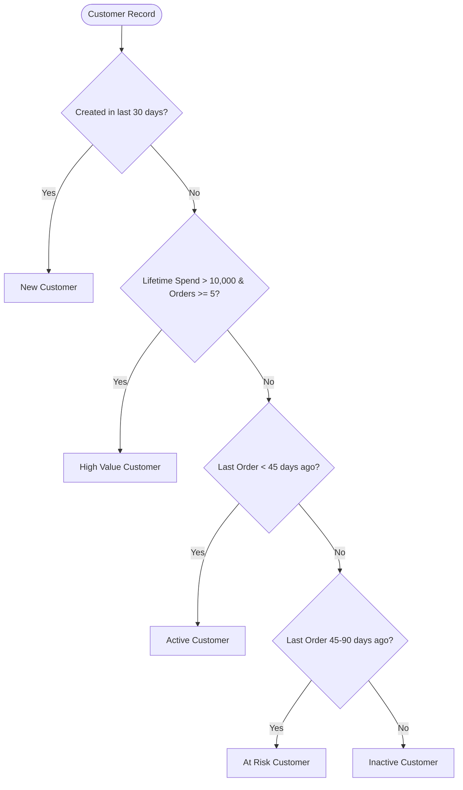

# Washora — Phase 11: Analytics & Business Intelligence Engine

## 1. Analytics Domain Matrix

Washora Phase 11 provides deep operational intelligence across 11 distinct operational modules:

| Domain | Key Metrics | Aggregation Source | Primary Filters |
| :--- | :--- | :--- | :--- |
| **Executive Dashboard** | Total Revenue, Active Orders, New Customers, Expenses, Profit Margin, Delivery SLA | Cross-collection index aggregation | Date Range, Branch |
| **Sales Analytics** | Gross Sales, Net Sales, Tax, Collected Payments, Receivables, Discounts, AOV | `orders`, `payments` | Date Range, Branch, Payment Mode |
| **Order Analytics** | Pipeline volume, Bottleneck Stages, Average Cycle Time, Status Distribution | `orders`, `garments` | Date Range, Branch, Status |
| **Customer Intelligence** | RFM Segmentation, Lifetime Value, Repeat Customer Rate, Cohort Retention | `customers`, `orders` | Date Range, Segment, Branch |
| **Service & Catalog** | Sales volume per Service, Category contribution, Fabric distribution | `orders.items`, `services` | Date Range, Category, Branch |
| **Branch Comparison** | Multi-unit Revenue, Volume, Margin, Staff productivity | `orders`, `branches`, `expenses` | Date Range |
| **Payment Analytics** | Gateway breakdowns, Cash vs Digital ratios, Refund counts | `payments` | Date Range, Branch, Method |
| **Financial P&L** | Revenue vs Operating Expenses vs Stock Consumed vs Payroll | `orders`, `expenses`, `payroll` | Date Range, Branch |
| **Inventory Intelligence** | Stock Valuation, Low Stock Alerts, Consumption Velocity | `inventory_items`, `stock_movements`| Branch, Category, Stock Level |
| **Plant & QC** | Stage cycle duration, Inspection pass rate, Defect categories | `garments`, `qc_inspections` | Date Range, Stage, Defect Type |
| **Logistics** | Pickup & Delivery SLA, Dispatch success rate, Driver workload | `pickups`, `deliveries` | Date Range, Branch, Driver |

---

## 2. Rule-Based Customer Segmentation (No-AI Guarantee)

To maintain 100% deterministic accuracy and auditability, Washora uses clear rule-based segmentation:

---

## 3. Cohort Retention Matrix Engine

Monthly acquisition cohorts track long-term loyalty without heavy iterative table scans:
1. Groups customers by their initial order month (`cohortMonth`).
2. Calculates subsequent order activity for $M+1, M+2, \dots, M+6$ using indexed date projection in MongoDB `$facet` pipelines.
3. Computes active retention percentages relative to the starting cohort size.

---

## 4. Bottleneck Detection & Plant SLA Tracking

Processing bottlenecks are detected by querying active orders and garments in intermediate states (`SORTING`, `WASHING`, `DRYING`, `IRONING`, `QUALITY_CHECK`):
- Measures time in state against the tenant's standard SLA threshold (e.g. 24 hours).
- Visualizes real-time garment counts piled up in any specific plant workstation.
